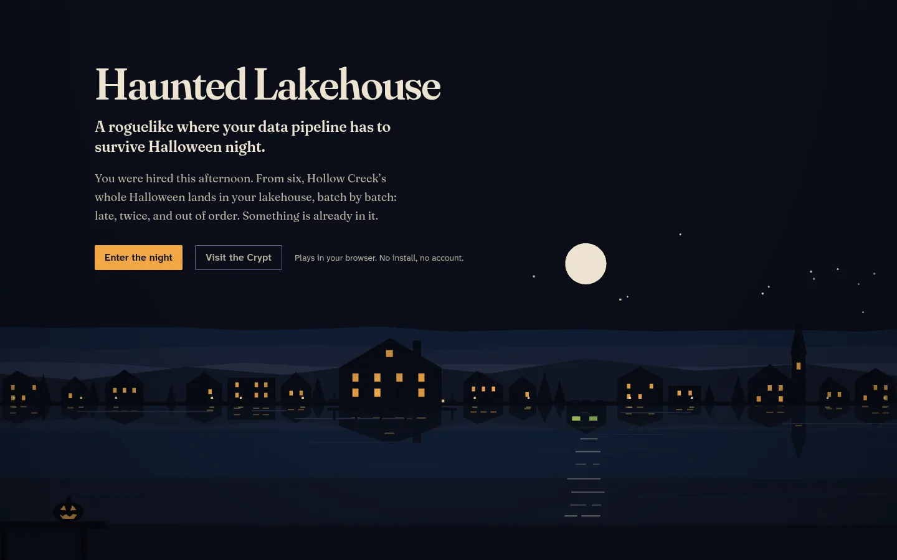
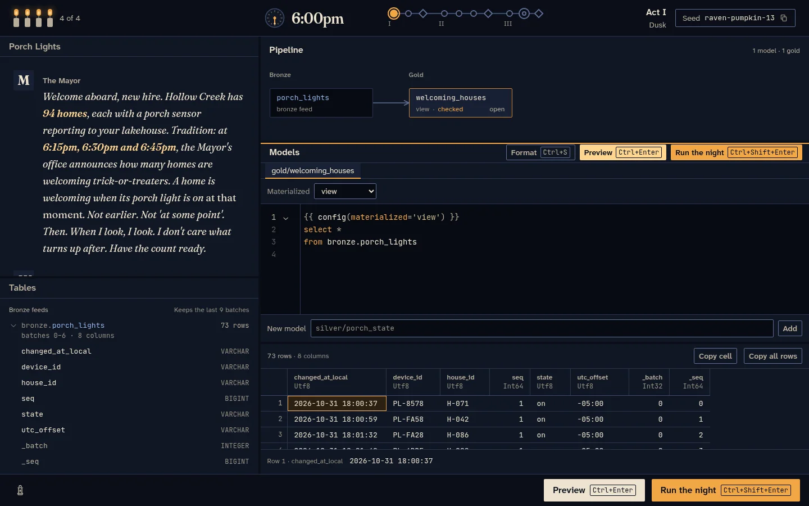

# Haunted Lakehouse

A roguelike where your data pipeline has to survive Halloween night.

Hollow Creek runs its whole Halloween on one lakehouse, and you were hired as its on-call data
engineer this afternoon. From 6pm to 3am the town's data lands batch by batch: porch sensors,
candy bowls, a vendor's feed. It arrives late, twice, out of order, and in shapes nobody agreed
to. Keep the numbers right while the night gets stranger, because something is already in the
lakehouse.

**[Play now](https://haunted-lakehouse-spike-03.vercel.app)** in the browser. No install, no
account.



## How it works

Each hour of the night is one puzzle. A character tells you what the town needs in their own
words, never in technical ones. The raw data is already in the lakehouse, and you build the
pipeline that answers the question.

- **Bronze, silver, gold.** Raw feeds land in `bronze`. You write SQL models that clean and
  shape them into `silver`, and `gold` models hold the answers the town checks. The pipeline
  graph updates as models reference each other.
- **Materializations.** A model is a `select` with a `config` header. A `view` is recomputed on
  read, a `table` is rebuilt after every batch, and an `incremental` model sees only the batch
  that just arrived plus its own current state, and merges on a `unique_key`.
- **Bronze forgets.** Each feed keeps only its last few batches, the way a message queue does.
  You can't rebuild from all of history, so the pipeline has to carry what it learns forward.
- **Preview** runs your pipeline over the batches you can see. It's free, so iterate as much as
  you like.
- **Run the night** replays the hour from the first batch, including **hidden batches** you
  haven't seen. At **checkpoints** (the Mayor checking a dashboard at 6:15pm, say), your gold
  tables are compared with what was true given only the data that had arrived by then.
- **Candles.** Pass every checkpoint and the hour is cleared. Fail one and a candle goes out,
  the night freezes on that checkpoint, and the batch that broke it becomes visible. You learn
  where it broke, never why. Run out of candles and the run ends.
- **Relics and curses.** Clearing an hour offers a choice of two relics, which give engineering
  intel but never answers: a feed's schema history, a peek at a hidden batch, the expected row
  count at the next checkpoint. Curses can open an hour, making it harder and the next relic
  better.
- **Seeds.** Every run has a seed like `raven-pumpkin-13`, and every seed generates its own data,
  so no two players' answers match. The Daily Haunt gives everyone the same seed, one attempt,
  and a leaderboard.

Between runs, the Crypt keeps your tombstones, the autopsies you've earned, and the ledger pages
that slowly explain what is haunting the town. Every cleared hour ends with an autopsy: what
really happened, the real-world version of the bug, and how production teams prevent it.



## Act I: Dusk

| Time   | Tier      | Puzzle              | The town's problem                                                                      |
| ------ | --------- | ------------------- | --------------------------------------------------------------------------------------- |
| 6:00pm | ★         | Porch Lights        | The Mayor wants to know how many homes are welcoming trick-or-treaters, right now.      |
| 6:45pm | ★★        | The Thirteenth Door | Any house that gave out exactly 13 pieces is cursed. Nobody counts pieces.              |
| 7:30pm | ★★ (boss) | The Possessed Feed  | The decorations vendor's feed turns strange mid-delivery, and the bill still comes due. |

Acts II and III, from 8:15pm to the 2:00am finale, are in progress.

## Stack

- **App:** Next.js (App Router), React, TypeScript in strict mode, Tailwind CSS.
- **Pipeline engine:** DuckDB-WASM in a Web Worker. Your pipeline runs entirely in your browser.
- **Editor:** CodeMirror 6 with SQL highlighting and schema-aware autocomplete.
- **Scenes:** PixiJS for the town, the clock, and the candles. Everything textual stays in the
  DOM.
- **Server:** Next.js route handlers create runs, generate seeded data, serve hidden batches,
  and validate checkpoints. Puzzle generators and expected answers are server-only and never
  ship to the browser.
- **Data:** Postgres with Drizzle ORM in production, and an embedded PGlite database in
  development and CI.
- **Tests:** Vitest on DuckDB's Node package, so pipeline semantics are tested on the same
  engine as the browser, and Playwright end to end.
- **Hosting:** Vercel.

## Run locally

You need [bun](https://bun.sh) and Node.js 24 (Vitest runs on Node).

```sh
bun install
```

The anonymous session cookie is signed with `SESSION_SECRET`. This writes a fresh one to
`.env.local` without printing it:

```sh
echo "SESSION_SECRET=$(node -p "require('node:crypto').randomBytes(32).toString('base64')")" >> .env.local
```

Then start the dev server and open http://localhost:3000:

```sh
bun run dev
```

No Postgres is needed. Development uses an embedded PGlite database in `.data/pglite`, created
and migrated on first use. `.env.example` documents every variable the app reads.

### Checks

```sh
bun run lint
bun run typecheck
bun run format:check
bun run test
bun run test:e2e
```

`bun run test:e2e` starts its own dev server on port 3100. On a first run, install a browser
with `bunx playwright install chromium`. Playwright's downloaded browsers don't run on NixOS, so
point it at a Nix-provided Chromium binary instead:

```sh
PLAYWRIGHT_CHROMIUM_EXECUTABLE=/path/to/chromium bun run test:e2e
```

## License

[MIT](LICENSE)
